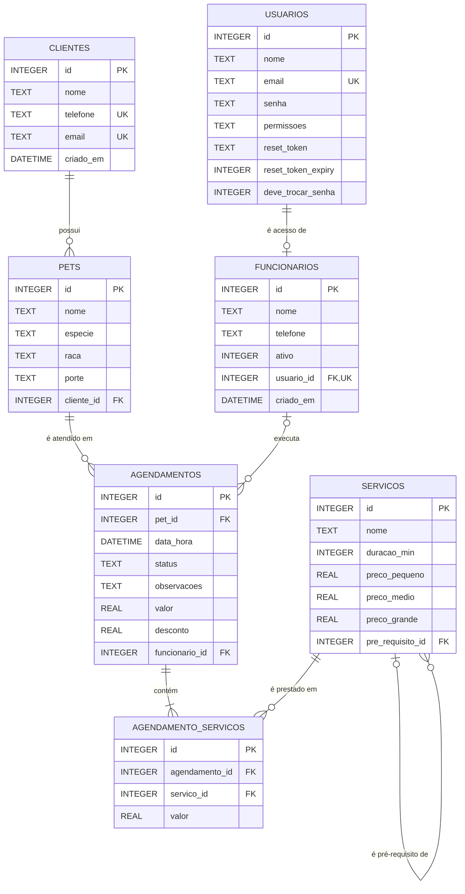

# DER — Modelo de Dados

Diagrama Entidade-Relacionamento do BiomaPetShop, extraído do schema que as migrations de
[database/migrations](../database/migrations) criam (001 e 002). Banco: SQLite (arquivo
`database/biomapet.sqlite`).

> As sessões de login ficam em um banco separado (`database/sessions.sqlite`), gerenciado
> pelo `connect-sqlite3`, e não fazem parte deste modelo.

---

## 1. Diagrama

---

## 2. Entidades

### 2.1. `usuarios`
Credenciais de acesso ao sistema. Todo login passa por esta tabela.

| Coluna | Tipo | Restrições | Observação |
|---|---|---|---|
| `id` | INTEGER | PK AUTOINCREMENT | |
| `nome` | TEXT | NOT NULL | |
| `email` | TEXT | NOT NULL, UNIQUE | Identificador de login |
| `senha` | TEXT | NOT NULL | Hash bcrypt (custo 10) |
| `permissoes` | TEXT | NOT NULL | `administrador` ou `funcionario` |
| `reset_token` | TEXT | — | Token de redefinição (32 bytes hex) |
| `reset_token_expiry` | INTEGER | — | Epoch em ms; validade de 1 hora |
| `deve_trocar_senha` | INTEGER | DEFAULT 0 | `1` obriga a trocar a senha no próximo login (BL-09) |

A coluna `senha_texto` saiu na migration 002 (BL-16). Ver
[DT-01](debitos-tecnicos.md#dt-01--senha-em-texto-puro-no-banco-senha_texto).

Registro semeado no primeiro boot: `admin@biomapet.com`, perfil `administrador`. A senha vem de
`ADMIN_INITIAL_PASSWORD` (obrigatória em produção; em desenvolvimento, sem a variável, é
`123456`) e o admin nasce com `deve_trocar_senha = 1`: a troca é obrigatória no primeiro
login (BL-09).

### 2.2. `clientes`
Tutores dos pets.

| Coluna | Tipo | Restrições | Observação |
|---|---|---|---|
| `id` | INTEGER | PK AUTOINCREMENT | |
| `nome` | TEXT | NOT NULL | Normalizado por `capitalize()` |
| `telefone` | TEXT | índice único parcial | Único quando não nulo/vazio (RN01) |
| `email` | TEXT | índice único parcial | Único quando não nulo/vazio (RN01) |
| `criado_em` | DATETIME | DEFAULT CURRENT_TIMESTAMP | |

Os índices são **parciais** (`WHERE ... IS NOT NULL AND ... != ''`), então vários clientes
podem coexistir sem telefone ou sem e-mail.

### 2.3. `pets`
Animais vinculados a um cliente.

| Coluna | Tipo | Restrições | Observação |
|---|---|---|---|
| `id` | INTEGER | PK AUTOINCREMENT | |
| `nome` | TEXT | NOT NULL | |
| `especie` | TEXT | NOT NULL | |
| `raca` | TEXT | — | Obrigatório na validação da rota, não no schema |
| `porte` | TEXT | — | `Pequeno`, `Médio` ou `Grande` — define o preço |
| `cliente_id` | INTEGER | NOT NULL, FK → `clientes(id)` ON DELETE CASCADE | O tutor; excluir o cliente exclui o pet |

O valor de `porte` é usado como chave de lookup em `calcularValores()`
([utils/helpers.js](../utils/helpers.js)) para escolher entre `preco_pequeno`,
`preco_medio` e `preco_grande`. Qualquer valor fora dessa lista cai silenciosamente
em `preco_medio`.

### 2.4. `funcionarios`
Dados operacionais do funcionário. O acesso ao sistema vem de `usuarios`; esta tabela
guarda o complemento (telefone, status ativo) e o vínculo.

| Coluna | Tipo | Restrições | Observação |
|---|---|---|---|
| `id` | INTEGER | PK AUTOINCREMENT | |
| `nome` | TEXT | NOT NULL | |
| `telefone` | TEXT | — | |
| `ativo` | INTEGER | DEFAULT 1 | `0` bloqueia o login |
| `usuario_id` | INTEGER | NOT NULL, UNIQUE, FK → `usuarios(id)` ON DELETE CASCADE | Vínculo 1-1 com `usuarios`; excluir o usuário exclui o funcionário |
| `criado_em` | DATETIME | DEFAULT CURRENT_TIMESTAMP | |

O email de login fica só em `usuarios.email`. As colunas `cpf` e `email`, que nunca eram
lidas, saíram na migration 002 (BL-16).

### 2.5. `servicos`
Catálogo de serviços com tabela de preço por porte.

| Coluna | Tipo | Restrições | Observação |
|---|---|---|---|
| `id` | INTEGER | PK AUTOINCREMENT | |
| `nome` | TEXT | NOT NULL | Sem UNIQUE — a deduplicação do seed é feita em código |
| `duracao_min` | INTEGER | DEFAULT 60 | Registrado, mas **não usado** em nenhum cálculo |
| `preco_pequeno` | REAL | DEFAULT 0 | |
| `preco_medio` | REAL | DEFAULT 0 | |
| `preco_grande` | REAL | DEFAULT 0 | |
| `pre_requisito_id` | INTEGER | FK → `servicos(id)` | Serviço que precisa estar no mesmo agendamento (RN04) |

Seed automático: Banho, Tosa, Hidratação, Consulta Básica e Corte de Unhas.

### 2.6. `agendamentos`
Atendimento agendado. Entidade central do sistema.

| Coluna | Tipo | Restrições | Observação |
|---|---|---|---|
| `id` | INTEGER | PK AUTOINCREMENT | |
| `pet_id` | INTEGER | NOT NULL, FK → `pets(id)` ON DELETE CASCADE | Excluir o pet exclui os agendamentos dele |
| `data_hora` | DATETIME | NOT NULL | Texto no formato `YYYY-MM-DD HH:MM:SS` |
| `status` | TEXT | DEFAULT `'pendente'` | Valores usados: `confirmado`, `concluido`, `cancelado` |
| `observacoes` | TEXT | — | |
| `valor` | REAL | — | Total calculado no servidor |
| `desconto` | REAL | DEFAULT 0 | Sempre `0` na implementação atual |
| `funcionario_id` | INTEGER | FK → `funcionarios(id)` ON DELETE SET NULL | `funcionarios.id`, não o id do usuário. Vai a NULL quando o funcionário é excluído |

O cliente do agendamento é o tutor atual do pet (`pets.cliente_id`). Até o BL-16 havia uma
cópia em `agendamentos.cliente_id`, que ficava com o cliente antigo quando o pet trocava de
tutor; ela saiu na migration 002, junto com a `servico_id`, legado da versão 1:1 substituído
por `agendamento_servicos`.

O `DEFAULT 'pendente'` nunca é exercido: a rota de criação grava `'confirmado'`
explicitamente. Ver [DT-05](debitos-tecnicos.md#dt-05--vocabulário-de-status-divergente).

### 2.7. `agendamento_servicos`
Tabela associativa N:N entre agendamento e serviço, com o preço congelado no momento
do agendamento.

| Coluna | Tipo | Restrições | Observação |
|---|---|---|---|
| `id` | INTEGER | PK AUTOINCREMENT | |
| `agendamento_id` | INTEGER | NOT NULL, FK → `agendamentos(id)` ON DELETE CASCADE | |
| `servico_id` | INTEGER | NOT NULL, FK → `servicos(id)` | |
| `valor` | REAL | DEFAULT 0 | Preço do porte no momento do agendamento |

Guardar `valor` aqui é intencional: se o preço do serviço mudar depois, o histórico
do agendamento não é reescrito.

---

## 3. Relacionamentos

| # | Relação | Cardinalidade | Implementação |
|---|---|---|---|
| R1 | `usuarios` → `funcionarios` | 1 : 0..1 | `funcionarios.usuario_id`, NOT NULL e UNIQUE |
| R2 | `clientes` → `pets` | 1 : N | `pets.cliente_id`, NOT NULL |
| R3 | `pets` → `agendamentos` | 1 : N | `agendamentos.pet_id`, NOT NULL |
| R4 | `funcionarios` → `agendamentos` | 1 : N (opcional) | `agendamentos.funcionario_id`, nulável |
| R5 | `agendamentos` ↔ `servicos` | N : N | via `agendamento_servicos` |
| R6 | `servicos` → `servicos` | 1 : N (opcional) | `servicos.pre_requisito_id`, nulável |

O agendamento não aponta direto para o cliente: o cliente é o tutor do pet (R2 + R3).

---

## 4. Integridade referencial

O `PRAGMA foreign_keys = ON` é aplicado em toda conexão do app
([database/db.js](../database/db.js)). Desde a migration 002 (BL-16), as regras de exclusão
estão declaradas no schema:

| Chave estrangeira | ON DELETE | Efeito de excluir o pai |
|---|---|---|
| `pets.cliente_id` → `clientes` | CASCADE | Remove os pets do cliente |
| `agendamentos.pet_id` → `pets` | CASCADE | Remove os agendamentos do pet |
| `agendamento_servicos.agendamento_id` → `agendamentos` | CASCADE | Remove os serviços do agendamento |
| `funcionarios.usuario_id` → `usuarios` | CASCADE | Remove o funcionário do usuário |
| `agendamentos.funcionario_id` → `funcionarios` | SET NULL | Mantém os agendamentos, sem o funcionário |
| `agendamento_servicos.servico_id` → `servicos` | NO ACTION | Recusa excluir serviço usado em agendamento |
| `servicos.pre_requisito_id` → `servicos` | NO ACTION | Recusa excluir serviço que é pré-requisito de outro |

As cascatas se encadeiam: excluir um cliente remove os pets, os agendamentos deles e os
serviços desses agendamentos; excluir um usuário remove o funcionário e deixa os
agendamentos dele sem funcionário. Vale também para um `DELETE` feito direto no banco. As
rotas fazem um único `DELETE` no registro principal:

- **Excluir pet, cliente ou agendamento:** `DELETE` na própria tabela
- **Excluir funcionário** ([routes/funcionarios.routes.js](../routes/funcionarios.routes.js)):
  `DELETE FROM usuarios`; a rota recusa excluir o admin

O banco também recusa pet sem cliente, agendamento sem pet e funcionário sem usuário
(`NOT NULL`), apontar para um registro que não existe e dois funcionários para o mesmo
usuário (`UNIQUE`). Até o BL-16 as cascatas eram feitas pelas rotas e um `DELETE` direto
deixava órfãos; ver
[DT-06](debitos-tecnicos.md#dt-06--cascata-de-exclusão-vive-no-código-não-no-schema).
Para procurar órfãos num banco, rode `npm run diagnostico`, que só lê o banco do `DB_PATH`.

> **No `sqlite3` de linha de comando, a cascata só funciona depois de
> `PRAGMA foreign_keys = ON;`.** O SQLite desliga as chaves estrangeiras em cada conexão
> nova, e o app liga só na dele. Sem o PRAGMA, um `DELETE` feito no terminal não apaga os
> filhos, não anula o `funcionario_id` e deixa órfãos. Rode o PRAGMA logo depois de abrir o
> banco, em cada sessão.

---

## 5. Regras de negócio que tocam o modelo

| Regra | Onde é aplicada |
|---|---|
| RN01 — unicidade de e-mail e telefone do cliente | Índices únicos parciais + checagem prévia na rota |
| RN02 — máximo de 3 agendamentos por horário | `COUNT` com `strftime('%Y-%m-%d %H', data_hora)` na rota de agendamentos |
| RN03 — mesmo pet sem serviços sobrepostos no mesmo horário | `JOIN` em `agendamento_servicos` na rota |
| RN04 — Tosa e Hidratação exigem Banho | `validarDependenciasServicos()` em [utils/helpers.js](../utils/helpers.js) |
| RN05 — excluir pet remove os agendamentos | `ON DELETE CASCADE` em `agendamentos.pet_id` |
| RN06 — só admin exclui usuário e redefine senha | `verificarAdmin` |

Fora a RN01 (índices únicos) e a RN05 (cascata), essas regras dependem do código da rota.
Um `INSERT` manual passa por cima delas.
